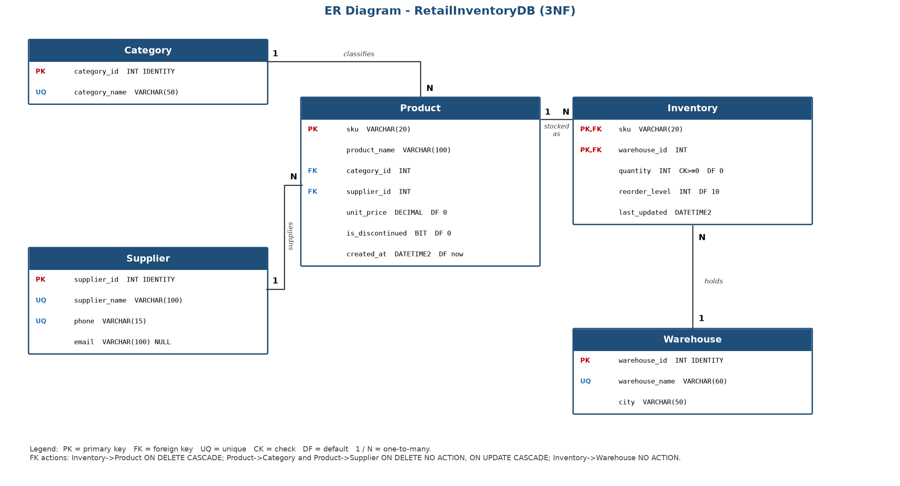
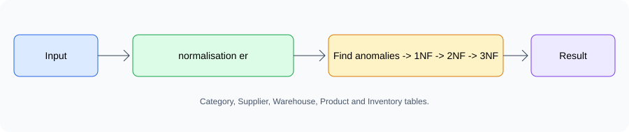

# Question 1 – Normalisation to 3NF and ER Diagram

## Query files – original spreadsheet

| SKU | Product | Category | Supplier | Supplier phone | Warehouse | Qty | Reorder |
|---|---|---|---|---|---|---|---|
| SKU-1001 | Bluetooth Speaker | Electronics | Chennai Electronics | +91 9840022222 | WH-Chennai-North | 120 | 20 |
| SKU-1001 | Bluetooth Speaker | Electronics | Chennai Electronics | +91 9840022222 | WH-Bengaluru | 45 | 20 |
| SKU-1002 | USB-C Charger 25W | Electronics | Chennai Electronics | +91 9840022222 | WH-Chennai-North | 300 | 50 |
| SKU-1003 | Basmati Rice 5kg | Groceries | Kaveri Foods Pvt Ltd | +91 9840033333 | WH-Chennai-South | 500 | 100 |

Functional dependencies: SKU → product name, category, supplier; supplier → phone; (SKU, warehouse) → quantity, reorder level.

## Anomalies in the original sheet

| Type | Example |
|---|---|
| Insert | A new supplier or warehouse cannot be added until some product is stocked there, because every row needs a SKU. |
| Update | If Chennai Electronics changes its phone, it must be edited in every row of every SKU it supplies. Missing one leaves two phone numbers. |
| Delete | Deleting the last row of SKU-1003 also deletes the only record of Kaveri Foods and its phone. |

## Steps

- **1NF:** one value per cell, key = (SKU, warehouse). Free-text reviews are moved out (to MongoDB, Task 5).
- **2NF:** product name, category and supplier depend only on SKU, so they move to **Product**. Warehouse details move to **Warehouse**. Only quantity and reorder level stay in **Inventory (sku, warehouse_id)**.
- **3NF:** supplier phone depends on the supplier, not the SKU, so it moves to **Supplier**. Category name moves to **Category**.

## Output – final tables

| Table | Primary key | Columns | Foreign keys |
|---|---|---|---|
| Category | category_id | category_name (UNIQUE) | – |
| Supplier | supplier_id | supplier_name (UNIQUE), phone (UNIQUE), email | – |
| Warehouse | warehouse_id | warehouse_name (UNIQUE), city | – |
| Product | sku | product_name, unit_price, is_discontinued, created_at | category_id, supplier_id |
| Inventory | (sku, warehouse_id) | quantity (CHECK >= 0), reorder_level, last_updated | sku, warehouse_id |

Assumption: the reorder level can differ per warehouse, so it stays in Inventory.

## ER diagram

## Approach

