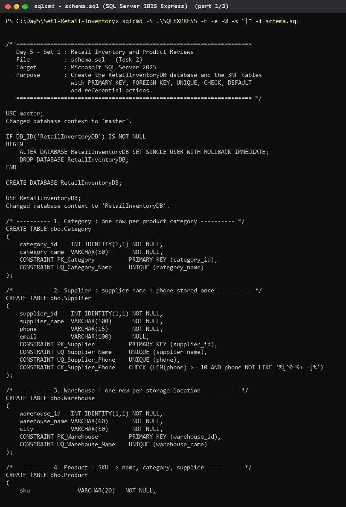
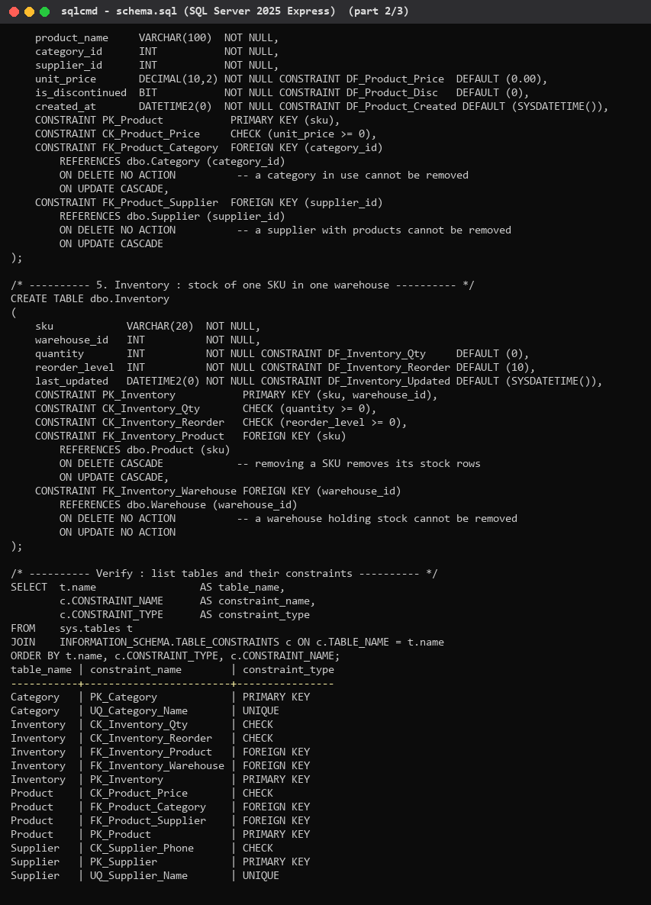
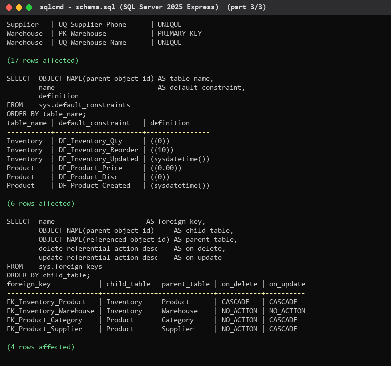

# Task 2 – Create Database and Tables

Creates RetailInventoryDB with PRIMARY KEY, FOREIGN KEY, UNIQUE, CHECK (quantity >= 0), DEFAULT and referential actions (Inventory → Product ON DELETE CASCADE; Product → Category / Supplier ON DELETE NO ACTION, ON UPDATE CASCADE).

## Input

- [schema.sql](schema.sql)

## Output

**Constraints, defaults and foreign keys created**

