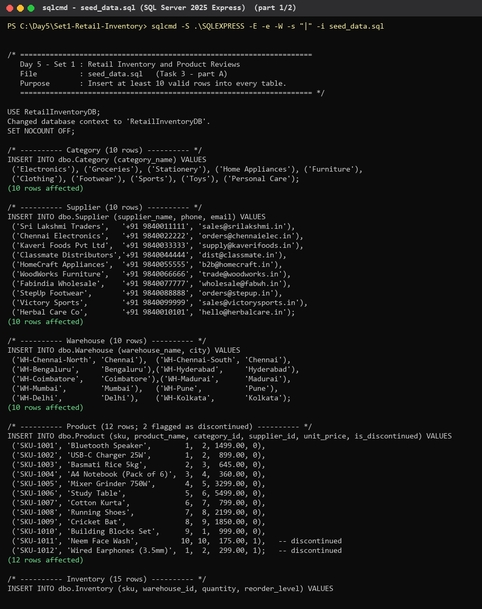
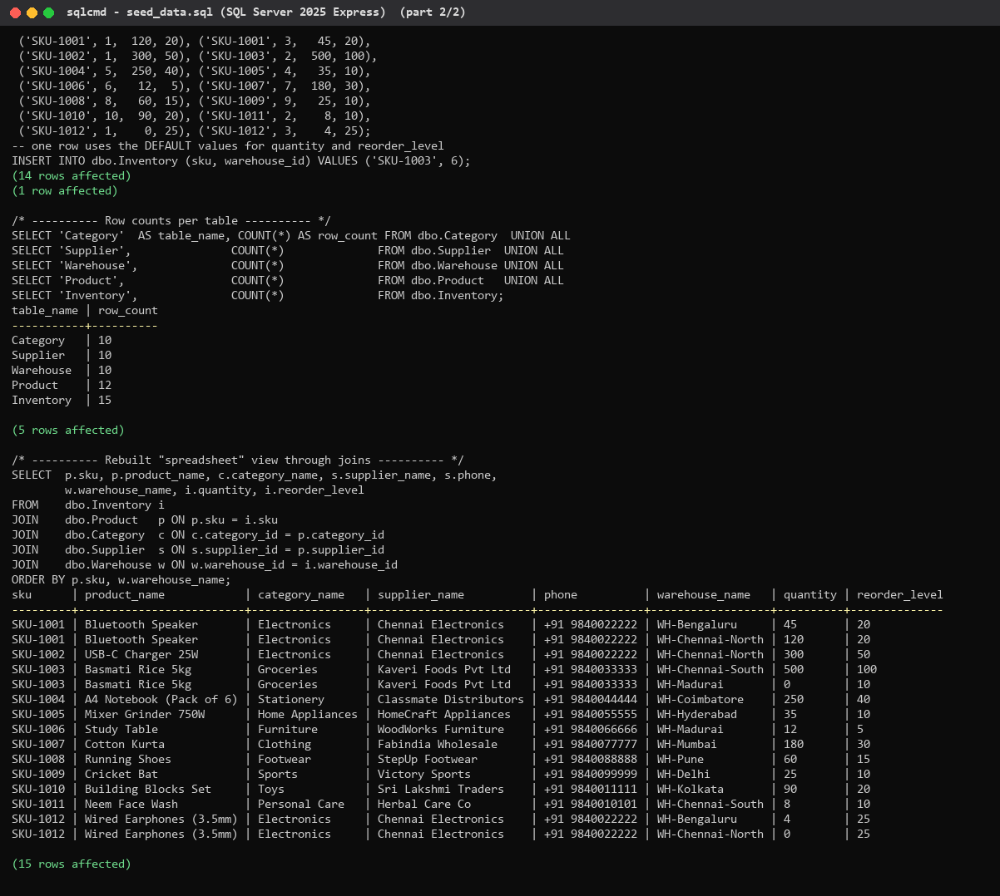
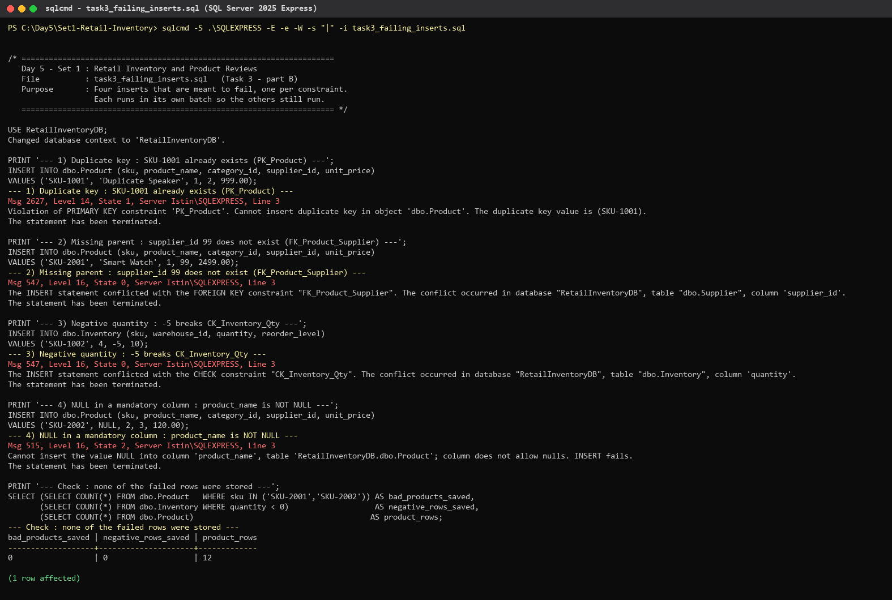

# Task 3 – Insert Data and Failing Inserts

`seed_data.sql` inserts 10 or more rows into every table. `task3_failing_inserts.sql` runs four inserts that must fail:

| # | Insert | Constraint | Error |
|---|---|---|---|
| 1 | duplicate SKU-1001 | PK_Product | Msg 2627 |
| 2 | supplier_id 99 | FK_Product_Supplier | Msg 547 |
| 3 | quantity -5 | CK_Inventory_Qty | Msg 547 |
| 4 | product_name NULL | NOT NULL | Msg 515 |

## Input

- [seed_data.sql](seed_data.sql)
- [task3_failing_inserts.sql](task3_failing_inserts.sql)

## Output

**Seed data**

**Row counts and the rebuilt spreadsheet view**

**Four failing inserts**

