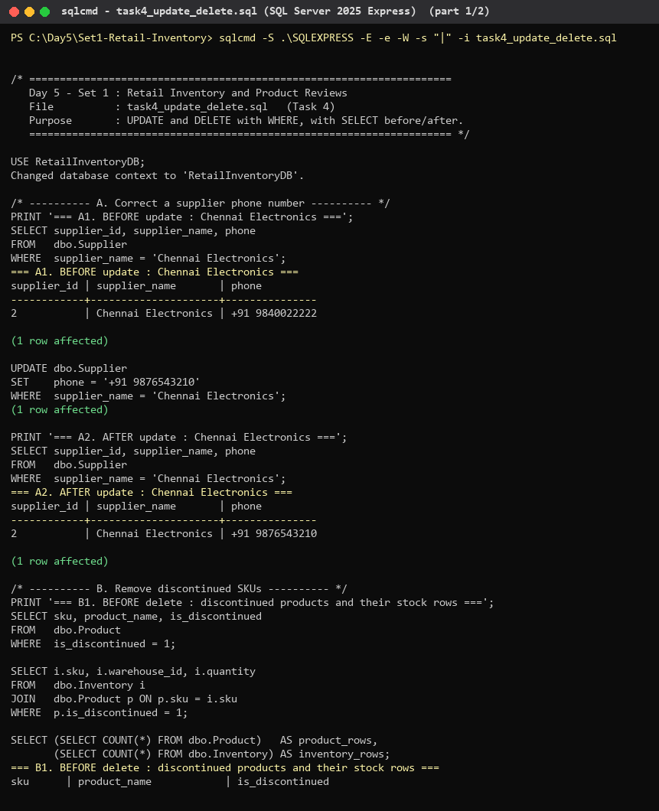
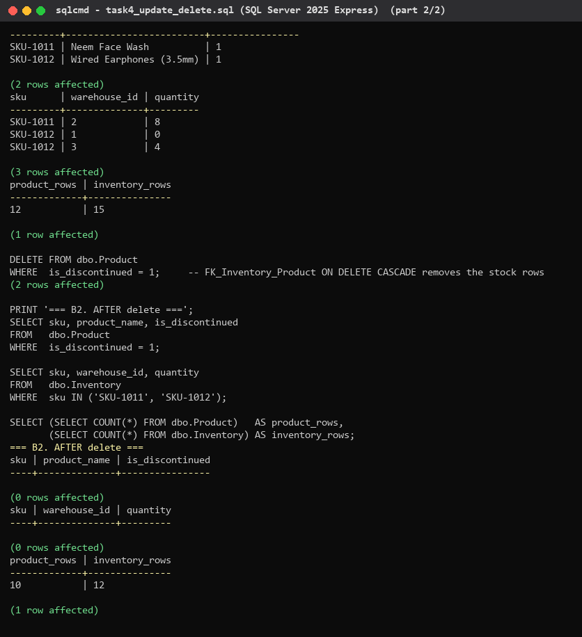

# Task 4 – UPDATE and DELETE with WHERE

Corrects the phone number of Chennai Electronics and removes the two discontinued SKUs. Their three stock rows are removed automatically by ON DELETE CASCADE (products 12 → 10, inventory rows 15 → 12).

## Input

- [task4_update_delete.sql](task4_update_delete.sql)

## Output

**Before / after**

