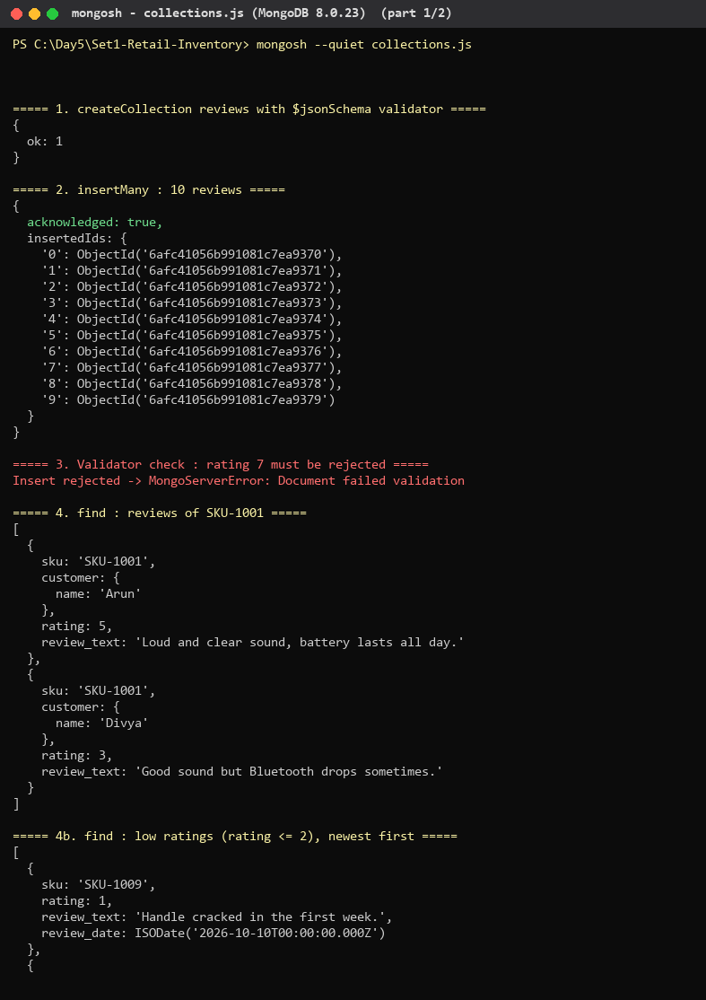
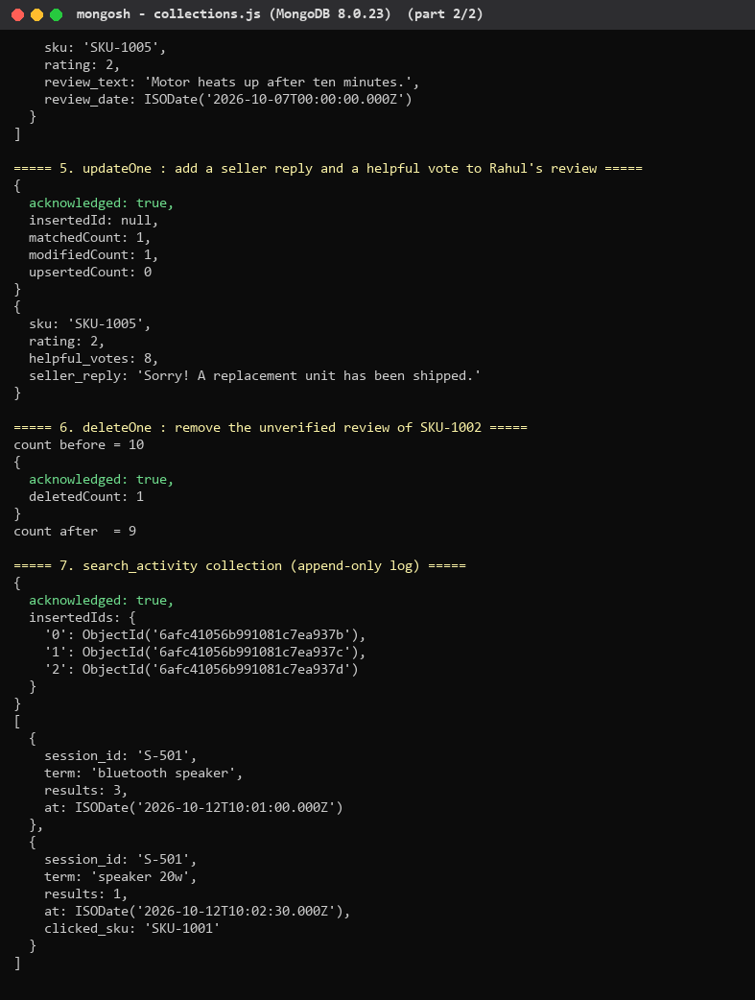
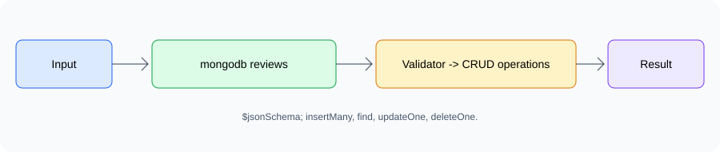

# Question 5 – MongoDB Reviews Collection

| Data | Store | Reason |
|---|---|---|
| Product reviews | MongoDB | Free text whose shape changes (tags, photos, seller replies), read per product, no joins. |
| Search activity | MongoDB | High-volume append-only events with varying filters, read by session or time. |
| Products, suppliers, stock | SQL Server | Fixed structure that needs keys, CHECK rules and transactions. |

The reviews collection has a `$jsonSchema` validator. The script runs insertMany, find, updateOne and deleteOne, and shows a review with rating 7 being rejected.

## Query files

- [collections.js](collections.js)

## Output

Full text output: [output.txt](output.txt)

## Approach

