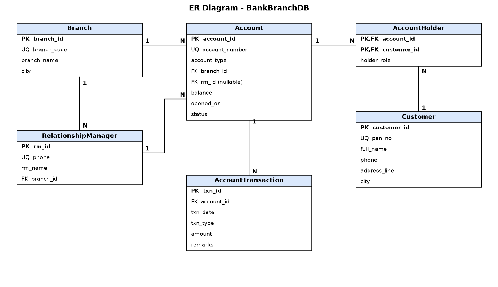

# Task 1 – Normalisation and ER Diagram

## Input

One row per account: customer, address, account number, account type, branch, relationship manager, balance and last
transaction text. Customer, branch and manager details repeat in every row.

Functional dependencies:

- account_number → account_type, branch, relationship manager, balance, opened_on
- customer (PAN) → name, address, phone
- branch_code → branch_name, city
- rm → rm_name, phone, branch
- (account_number, customer) → holder_role (joint accounts)

## Steps

- **1NF:** one value per cell; the last transaction text becomes its own table with date, type, amount and remarks.
- **2NF:** an account can have joint holders, so the link table key is (account_id, customer_id). Customer details depend only on the customer and move to Customer.
- **3NF:** branch name / city depend on the branch, not the account, so they move to Branch. Manager details move to RelationshipManager.
- **BCNF:** in every table each determinant is a candidate key (account_number, pan_no, branch_code and rm phone are UNIQUE).

## Output – keys

| Table | Primary key | Other candidate key | Composite |
|---|---|---|---|
| Branch | branch_id | branch_code | – |
| RelationshipManager | rm_id | phone | – |
| Customer | customer_id | pan_no | – |
| Account | account_id | account_number | – |
| AccountHolder | (account_id, customer_id) | – | Yes |
| AccountTransaction | txn_id | – | – |

## ER diagram

