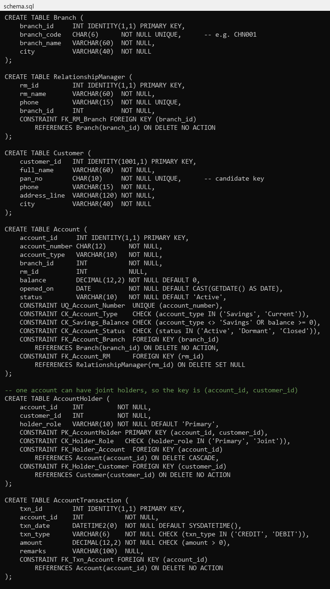
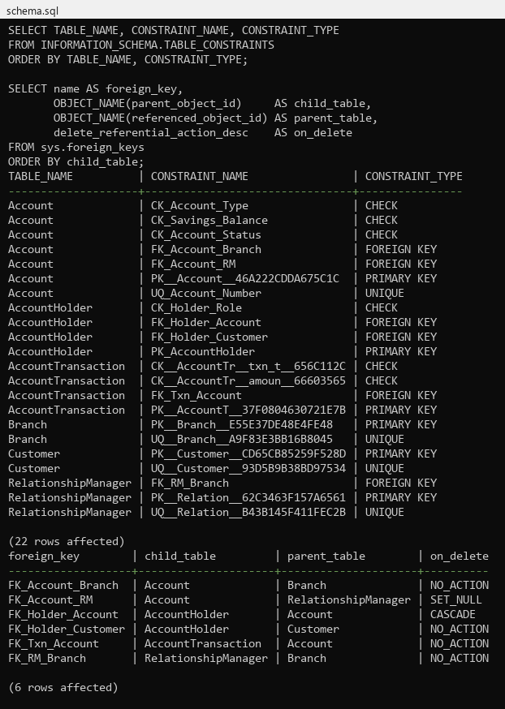
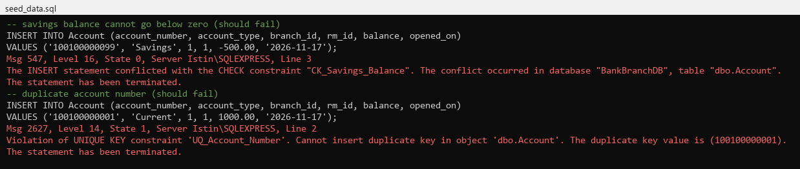

# Task 2 – Create Tables

IDENTITY keys, UNIQUE account numbers, and `CK_Savings_Balance` so a savings balance cannot go below 0 (a current account can, as overdraft).

**Cascading rules**

- AccountHolder → Account: **ON DELETE CASCADE**. A holder link means nothing once the account is gone.
- AccountHolder → Customer: **NO ACTION**. A customer who still has accounts should not be deleted.
- Account → RelationshipManager: **SET NULL**. If a manager leaves, the account stays and gets a new manager later.
- Account → Branch, RelationshipManager → Branch: **NO ACTION**. A branch with accounts or staff cannot be removed.
- AccountTransaction → Account: **NO ACTION**. Transaction history must never be deleted automatically.

## Input

- [schema.sql](schema.sql)

## Output

**Create tables**

**Constraints and foreign keys**

**Testing CHECK and UNIQUE**

