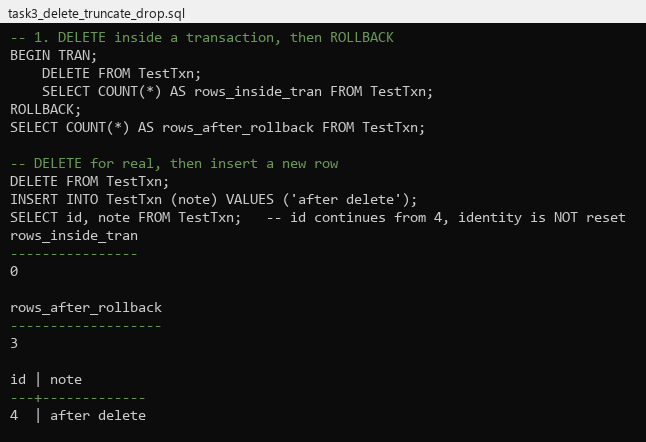
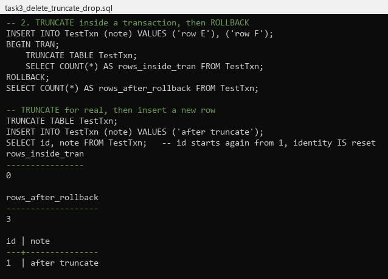
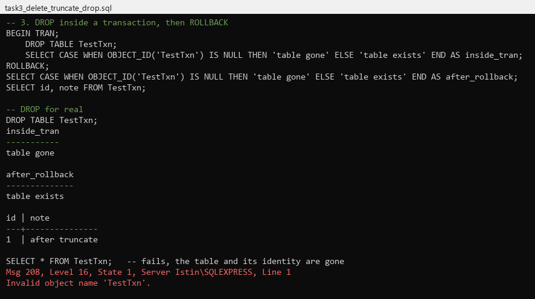

# Task 3 – DROP vs TRUNCATE vs DELETE

Each command is run on a test table first inside `BEGIN TRAN ... ROLLBACK`, then for real.

| Command | Identity after new insert | Rolled back? | Result |
|---|---|---|---|
| DELETE | continues (new id 4) | yes, rows came back | rows removed, table and identity stay |
| TRUNCATE | reset to seed (new id 1) | yes, rows came back | all rows removed at once, table stays |
| DROP | gone with the table | yes, table came back | whole table removed, SELECT gives Msg 208 |

## Input

- [task3_delete_truncate_drop.sql](task3_delete_truncate_drop.sql)

## Output

**DELETE**

**TRUNCATE**

**DROP**

