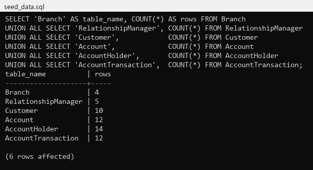
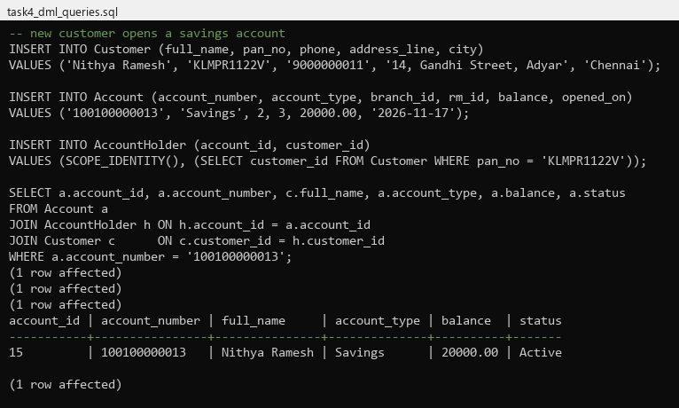
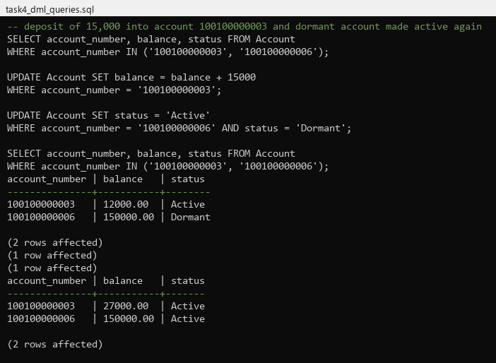
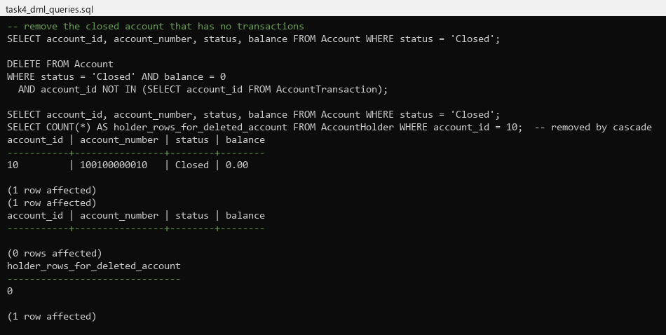
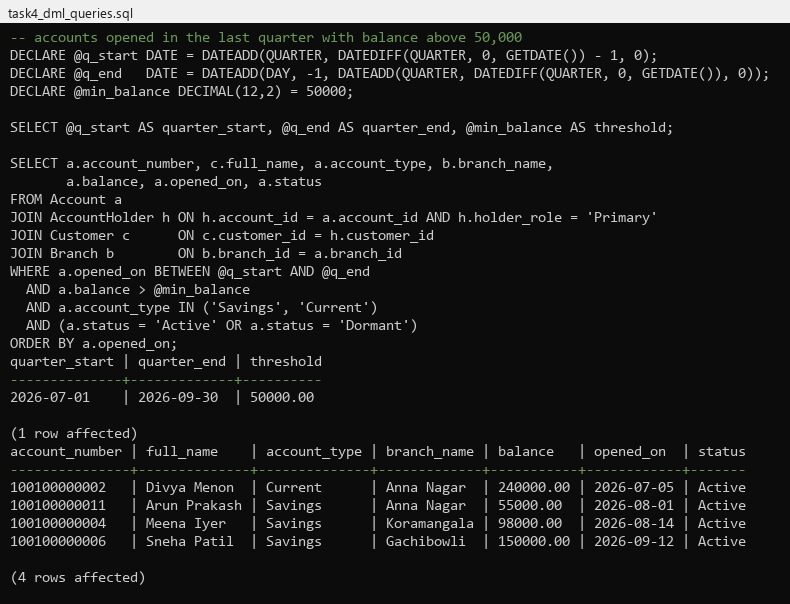
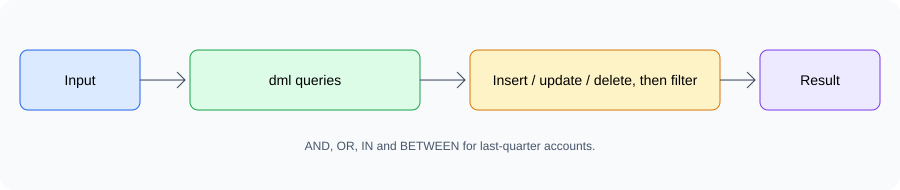

# Question 4 – Insert, Update, Delete and Retrieve

Sample data is in `seed_data.sql`. `task4_dml_queries.sql` inserts a new account, updates balances / status, deletes a closed account, and lists accounts opened in the last quarter (1 Jul – 30 Sep 2026) with balance above 50,000 using BETWEEN, AND, IN and OR.

## Query files

- [seed_data.sql](seed_data.sql)
- [task4_dml_queries.sql](task4_dml_queries.sql)

## Output

Full text output: [output.txt](output.txt)

**Rows inserted**

**Insert**

**Update (before / after)**

**Delete (before / after)**

**Accounts opened last quarter above 50,000**

## Approach

