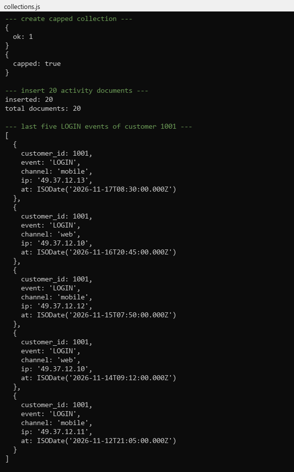

# Task 5 – Activity Logs in a Capped Collection

A capped collection `activity_logs` (1 MB, max 5000 documents) gets 20 activity documents, then the last five LOGIN events of customer 1001 are queried.

## Why activity logs are better in MongoDB than SQL Server

- Each event has different fields (a login has IP and browser, a transfer has amount and accounts, a bill payment has a biller). In SQL Server this needs many NULL columns or extra tables; in MongoDB each document keeps only its own fields.
- Logs are written very often and never updated. A capped collection keeps insertion order and removes the oldest logs automatically, so no cleanup job is needed.
- Logs are read for one customer and a time range, with no joins: a simple `find().sort().limit()`.
- Keeping this high-volume data out of SQL Server keeps the account tables small and fast.

## Input

- [collections.js](collections.js)

## Output

