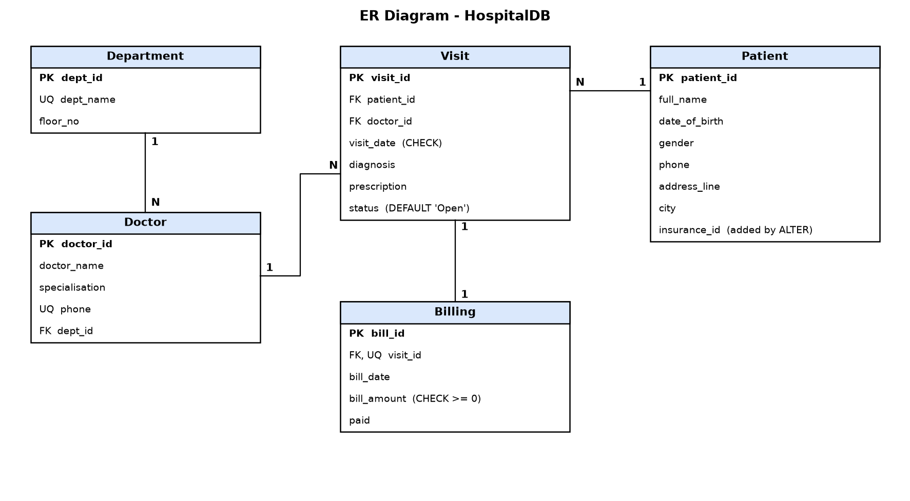
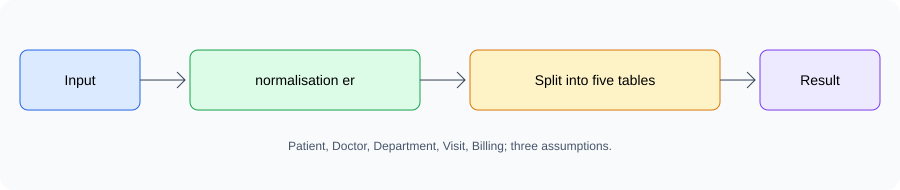

# Question 1 – Normalisation to 3NF

## Query files

One row per visit: patient, address, doctor, department, visit date, diagnosis, prescription, bill amount and notes.
Patient and doctor details repeat on every visit, and the department name repeats for every doctor.

## Decomposition steps

- **1NF:** one value per column. Free-text notes are taken out because their structure changes per visit (MongoDB, Task 5). Each row is identified by visit_id.
- **2NF:** patient details depend only on the patient, so they move to **Patient**. Doctor name and specialisation depend only on the doctor, so they move to **Doctor**. Visit keeps patient_id and doctor_id.
- **3NF:** department name depends on the doctor, not the visit (visit → doctor → department), so it moves to **Department** and Doctor keeps dept_id.
- **Billing:** bill amount, date and paid flag describe the payment, not the medical visit, so they move to **Billing**, linked by a UNIQUE visit_id.

## Output – final tables

| Table | Primary key | Columns |
|---|---|---|
| Department | dept_id | dept_name (UNIQUE), floor_no |
| Doctor | doctor_id | doctor_name, specialisation, phone, dept_id (FK) |
| Patient | patient_id | full_name, date_of_birth, gender, phone, address_line, city |
| Visit | visit_id | patient_id (FK), doctor_id (FK), visit_date, diagnosis, prescription, status |
| Billing | bill_id | visit_id (FK, UNIQUE), bill_date, bill_amount, paid |

## ER diagram

## Assumptions

1. Each visit is with one doctor and has at most one bill.
2. A doctor works in only one department.
3. The prescription is short text stored with the visit; detailed clinical notes are stored in MongoDB.

## Approach

