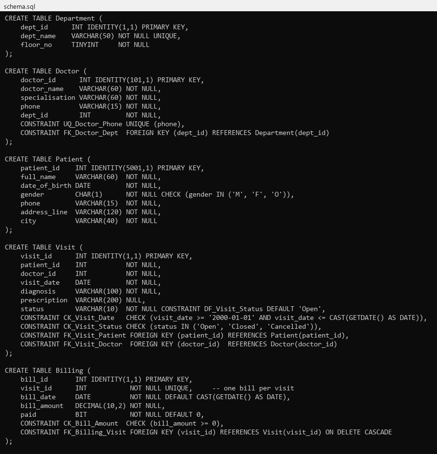
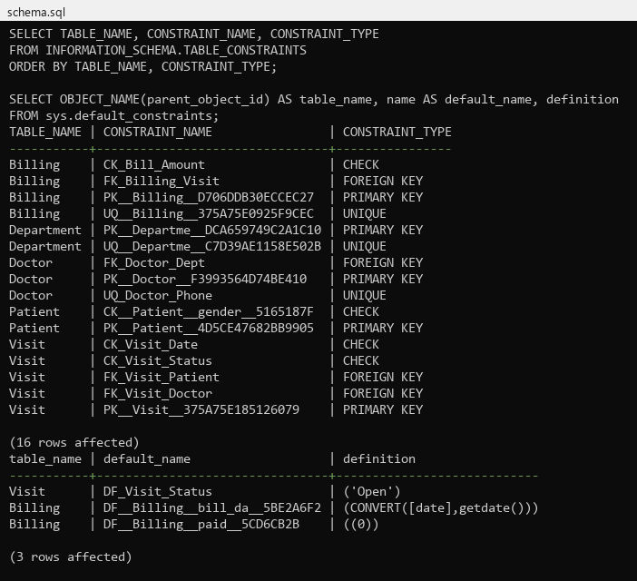
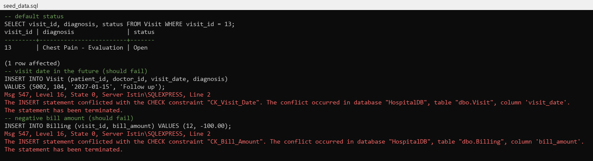

# Task 2 – Create Database and Tables

`CK_Visit_Date` allows visit dates from 2000-01-01 up to today, `CK_Bill_Amount` does not allow a negative amount, and `DF_Visit_Status` sets the status to 'Open' by default.

## Input

- [schema.sql](schema.sql)

## Output

**Create tables**

**Constraints created**

**Default status and CHECK tests**

