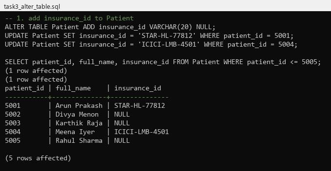
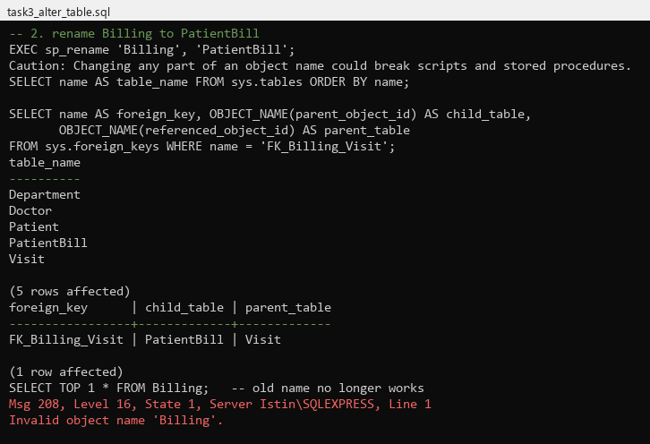
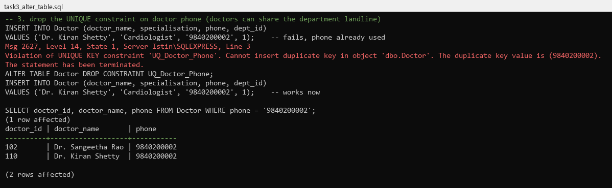
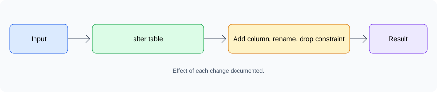

# Question 3 – ALTER TABLE

| Change | Command | Effect |
|---|---|---|
| Add column | `ALTER TABLE Patient ADD insurance_id VARCHAR(20) NULL` | Column added at the end; existing patients get NULL until updated. |
| Rename table | `EXEC sp_rename 'Billing', 'PatientBill'` | Data, keys and foreign keys move with it. SQL Server shows a caution, and the old name fails (Msg 208). |
| Drop constraint | `ALTER TABLE Doctor DROP CONSTRAINT UQ_Doctor_Phone` | Before: duplicate phone rejected (Msg 2627). After: the same insert works, so doctors can share a landline. |

## Query files

- [task3_alter_table.sql](task3_alter_table.sql)

## Output

Full text output: [output.txt](output.txt)

**Add column**

**Rename table**

**Drop constraint**

## Approach

