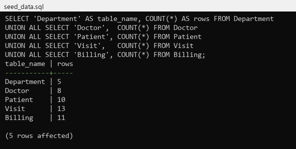
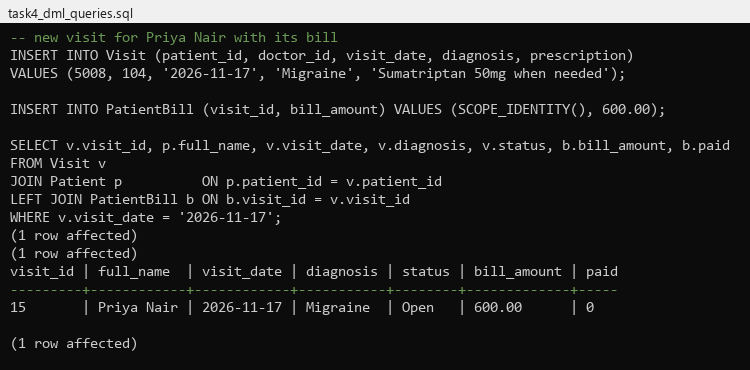
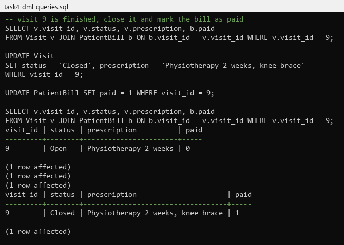
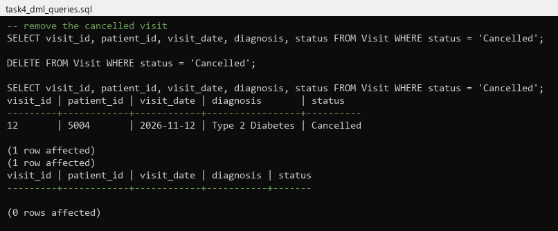
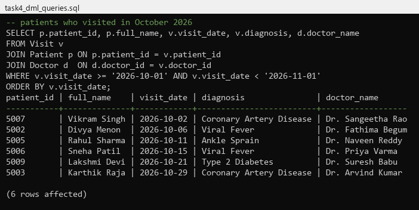
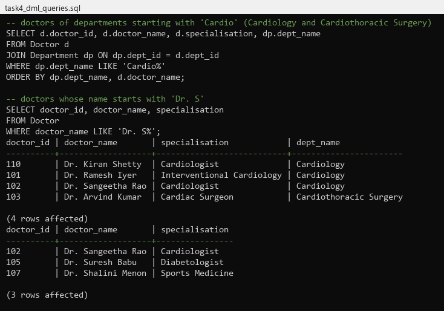

# Task 4 – Insert, Update, Delete and Retrieve

Sample data is in `seed_data.sql`. `task4_dml_queries.sql` adds a visit with its bill, closes a visit, deletes the cancelled visit, lists patients who visited in October 2026 and finds doctors with `LIKE 'Cardio%'` and `LIKE 'Dr. S%'`.

## Input

- [seed_data.sql](seed_data.sql)
- [task4_dml_queries.sql](task4_dml_queries.sql)

## Output

**Rows inserted**

**Insert**

**Update (before / after)**

**Delete (before / after)**

**Patients who visited in October 2026**

**Doctors using LIKE**

