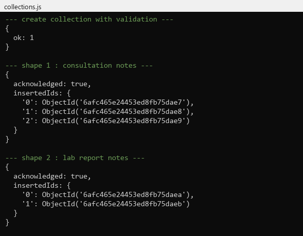
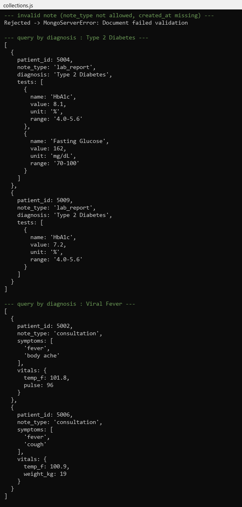
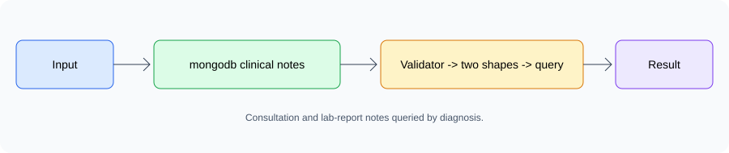

# Question 5 – Clinical Notes in MongoDB

Notes have two shapes: a **consultation** note (symptoms, vitals, plan) and a **lab report** (list of tests with value, unit and range). The `$jsonSchema` validator checks only the common fields (patient, visit, doctor, note_type, diagnosis, created_at), so both shapes are accepted. An invalid note is rejected, then notes are queried by diagnosis.

## Query files

- [collections.js](collections.js)

## Output

Full text output: [output.txt](output.txt)

**Create collection and insert both shapes**

**Invalid note rejected, queries by diagnosis**

## Approach

